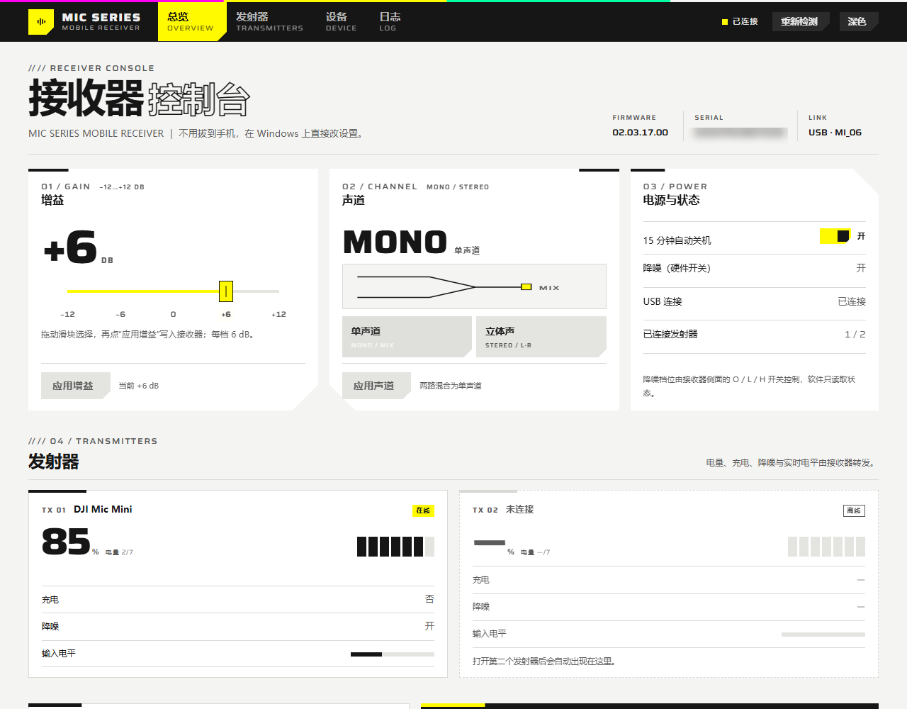
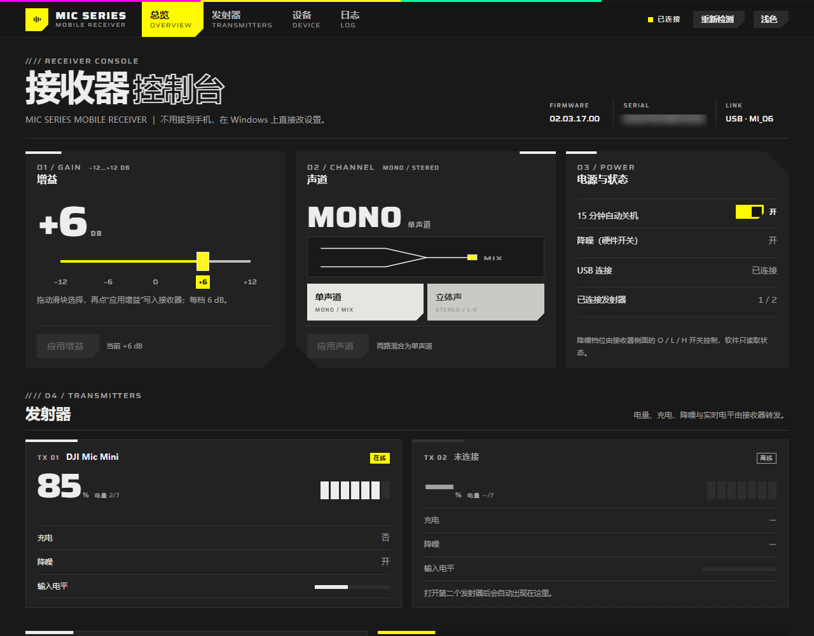

# Mic Series Mobile Receiver 电脑控制台

在 Windows 上直接读取并修改 **DJI Mic 系列手机版接收器**（USB-C 直插手机的那只小接收器）的增益、声道和自动关机，不用每次拔下来插回手机。接收器支持 Mic Mini / Mic 2 / Mic 3 发射器，所以这版不再只叫“Mic Mini 2”。





> 截图中的接收器序列号已隐去。

> 非官方工具，与 DJI 无关联。协议来自社区逆向，固件升级后可能失效。改设置有风险，请先阅读[风险与限制](#风险与限制)。

## 它能做什么

- **改接收器增益**：拖动滑块在 −12 / −6 / 0 / +6 / +12 dB 之间选择，再点“应用增益”写入接收器
- **切换声道**：单声道（两路混合）/ 立体声（TX1 左、TX2 右），选好后点“应用声道”
- **开关 15 分钟自动关机**：点一下“开/关”立即写入接收器
- **读实时状态**：接收器固件/序列号、降噪开关与档位、USB 连接
- **读发射器状态**：TX1/TX2 电量档位、是否充电、降噪开关、实时输入电平
- **不需要 DJI Mimo、不需要安卓手机**；设置写入接收器后，拔下再插仍保留

## 它不能做什么

- 不刷固件、不进 DFU、不发未知命令（固件升级/重启命令被刻意排除）
- 不修改发射器的低切、LED、语音音色等设置（手机版接收器固件上未逐一验证）
- 不替代 DJI Mimo 的录制、监听、混连等全部功能
- 不支持 macOS/Linux（本项目只做 Windows；macOS 可用 [lavdeck](https://github.com/piedol/lavdeck)）

## 快速开始（exe）

1. 解压整个 `MicSeriesControl` 文件夹（不要只拖 exe 出来）
2. 右键 `driver\install_winusb.bat` → **以管理员身份运行**（只需一次）
3. 双击 `MicSeriesControl.exe`
4. 接收器插在电脑 USB-C 口上，界面显示“已连接”即可

界面用本机 Web 技术绘制，通过 Edge/Chrome 的**应用窗口**打开（没有地址栏和标签页），不是普通浏览器标签。Windows 10/11 自带 Edge，无需额外安装。

驱动安装脚本会：

- 创建一个本机自签名代码签名证书（`CN=DJI Mic PC Control Local Signing`）
- 把它加入“受信任的根证书颁发机构”和“受信任的发布者”
- 用 `pnputil` 给 `USB\VID_2CA3&PID_4011&MI_06` 绑定微软自带的 `winusb.sys`

**只影响 MI_06 控制接口**，音频接口 MI_01 和 HID 接口 MI_00 不动，录音照常。卸载见[卸载驱动](#卸载驱动)。

## 从源码运行

```powershell
# 任选一个 Python 3.10+
python -m dji_mic            # 新版 Web 界面（自动开 Edge/Chrome 应用窗口）
python -m dji_mic --classic  # 旧版 Tk 界面，作为兜底
```

或先跑命令行确认设备：

```powershell
python tools/mic_cli.py status
python tools/mic_cli.py set-gain 0
python tools/mic_cli.py set-channel stereo
```

## 已验证

在 Windows 10 22H2 x64 上实测：

| 项目 | 结果 |
|---|---|
| 接收器 | DJI Mic Mini 2，固件 `02.03.17.00`，序列号（已隐去） |
| 发射器 | DJI Mic Mini（TX1），固件 `02.03.17.00` |
| 读取状态 | 通过（增益 +6 dB、单声道、降噪开、自动关机开、TX1 100%） |
| 改增益 | `+6 → 0 → +6 dB` 往返成功，状态帧确认 |
| 改声道 | `单声道 → 立体声 → 单声道` 往返成功，状态帧确认 |
| 自动关机 | `开 → 关 → 开` 往返成功，状态帧确认 |
| 音频接口 | 修改设置后 `Wireless Mic Rx` 录音设备仍正常 |

## 工作原理

接收器是复合 USB 设备 `VID_2CA3 & PID_4011`：

| 接口 | 类型 | 用途 |
|---|---|---|
| MI_00 | HID | 媒体键/电话键与厂商自定义 collection |
| MI_01 | UAC 音频 | Windows 里看到的 `Wireless Mic Rx` 麦克风 |
| MI_06 | 厂商自定义 | DJI DUML 控制/状态流，Bulk OUT `0x06` / IN `0x86` |

Windows 没有 MI_06 的内置驱动，设备管理器里是 Problem 28。驱动脚本只给这一个接口绑定 `winusb.sys`，之后用户态就能用 `CreateFile` + `WinUsb_ReadPipe/WritePipe` 收发 DUML 帧。

应用做的事：

1. 枚举 `USB\VID_2CA3&PID_4011&MI_06` 的设备接口路径
2. 用 `FILE_FLAG_OVERLAPPED` 打开（同步句柄会让 `WinUsb_Initialize` 返回 6）
3. 后台线程读 `0x86`，按 `0x55 + 长度 + CRC8 + CRC16` 切帧
4. 解析 `0x5B/0x03` 状态推送（TLV：接收器、发射器、身份、电平）
5. 写设置时构造 `0x5B/0x01` 帧，TLV `0x0008` = 声道、`0x0039` = 增益、`0x0010` = 自动关机，等 ACK 并等状态帧确认

协议细节见 [`docs/PROTOCOL.md`](docs/PROTOCOL.md)，调研过程与替代方案见 [`docs/可行性报告.md`](docs/可行性报告.md)。

## 常见问题

**界面提示“控制接口缺少驱动”**

右键 `driver\install_winusb.bat` 以管理员身份运行。装完如果还是黄色感叹号，拔插一次接收器，或运行 `pnputil /scan-devices`。

**提示“接收器未连接”但设备管理器里有**

- 确认插的是接收器本体，不是充电盒
- 关掉可能占用 MI_06 的其他程序（例如同款托盘工具）
- 点“重新检测”

**改增益/声道没反应**

- 看日志里是否有“接收器拒绝了该设置”或“状态没有变化”
- 手机版接收器的降噪是侧面 O/L/H 硬件开关，软件不控制它；这是正常的
- 固件升级后协议可能变化，需要重新抓包

**会不会影响保修/变砖**

只写增益、声道、自动关机三个已验证设置，不碰固件升级/重启命令；但不保证 DJI 后续固件仍兼容。风险自负。

**杀软报毒**

自行用 PyInstaller 打包的 exe 没有代码签名，少数杀软会误报。可以改用源码运行。

## 卸载驱动

右键 `driver\uninstall_winusb.bat` → 以管理员身份运行。它会删除 `djimic_pc_winusb.inf` 驱动包和自签名证书，MI_06 回到 Problem 28；音频和 HID 不受影响。

## 目录

```
dji_mic/            应用代码（DUML、WinUSB、控制器、Web 服务、旧 Tk 界面）
web/                新版界面（HTML / CSS / JS / 字体 / 等高线）
driver/             WinUSB 绑定/卸载脚本与 INF
tools/              命令行、抓包、测试、图标工具
tests/              协议单元测试与真实帧夹具
docs/               截图、协议笔记、可行性报告、致谢
.github/            GitHub Actions 测试工作流
launcher.py         PyInstaller 入口
THIRD_PARTY_NOTICES.md  第三方代码、字体与协议来源许可
```

## 构建 exe

源码运行不需要第三方依赖；打包 exe 需要 PyInstaller：

```powershell
python -m pip install pyinstaller
python -m PyInstaller --noconfirm --clean --onefile --windowed `
  --name MicSeriesControl --icon assets/icon.ico `
  --add-data "web;web" launcher.py
```

产物在 `dist\MicSeriesControl.exe`。发布时把 exe、`driver\`、`README.md`、`使用说明.txt`、`LICENSE` 和 `docs\` 放进同一个文件夹，压缩成 zip；`release/` 已被 `.gitignore` 排除，建议把 zip 挂到 GitHub Releases，而不是提交进仓库。

## 许可与致谢

本项目代码以 MIT 许可发布。界面设计语言来自 [hhikr/endfield-ui-skill](https://github.com/hhikr/endfield-ui-skill)（其代码、模板与 token 可自由使用），Saira 字体为 SIL OFL 1.1；WinUSB 的 ctypes 管线与驱动 INF/脚本改编自 [hogancv/dji-mic-mini-monitor](https://github.com/hogancv/dji-mic-mini-monitor)（MIT）；协议事实来自 [ShadowBitBasher/DJI-Mic-Control](https://github.com/ShadowBitBasher/DJI-Mic-Control)（Unlicense）与 [piedol/lavdeck](https://github.com/piedol/lavdeck)（GPL-3.0，仅参考文档，未复制代码）。完整列表见 [`docs/CREDITS.md`](docs/CREDITS.md)，第三方许可全文见 [`THIRD_PARTY_NOTICES.md`](THIRD_PARTY_NOTICES.md)。

“DJI”“DJI Mic”“Mic Mini”“Mic 2”“Mic 3”是大疆创新的商标，本项目仅作兼容性说明使用。
